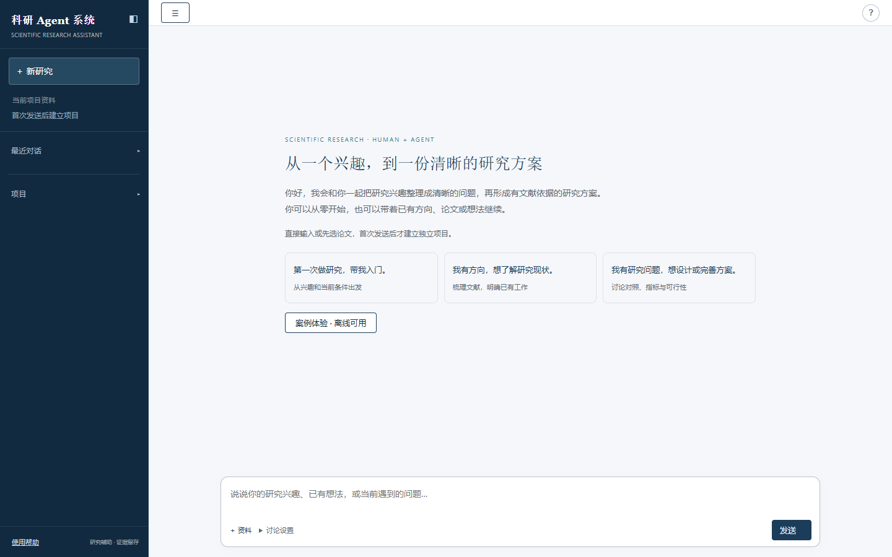
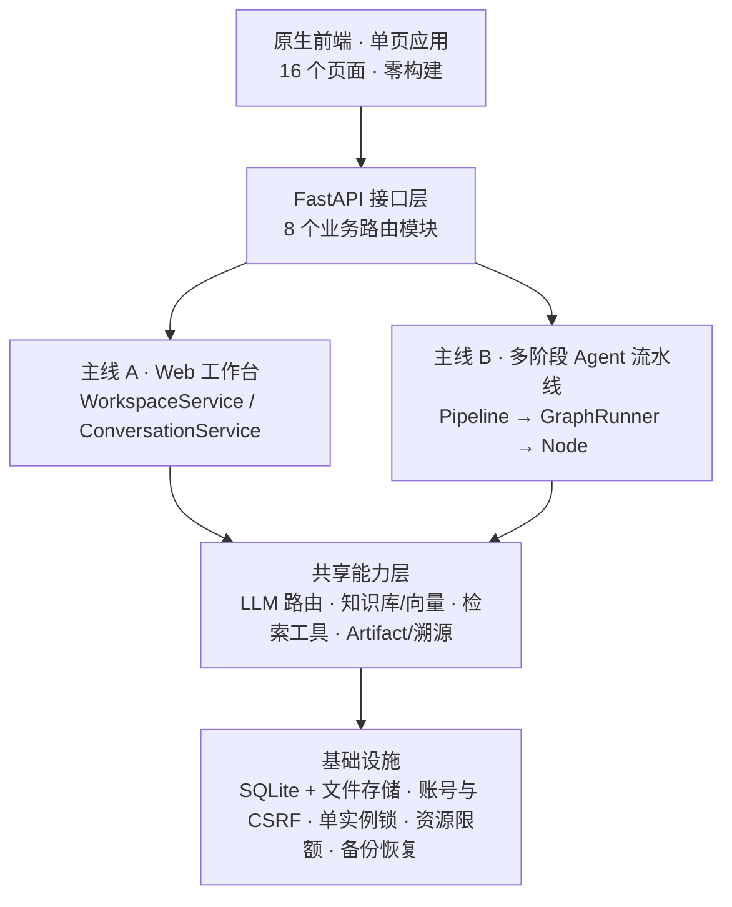

# Scientific Agent · 科研方案工作台

> 面向理工科研究者的智能科研工作台：从一篇论文、一个兴趣或一个问题出发，通过**有来源、可追溯的人机协作对话**，产出**可修订、可采纳、可下载**的研究方案。

[核心亮点](#核心亮点) · [技术栈](#技术栈) · [系统架构](#系统架构) · [核心功能](#核心功能) · [关键技术设计](#关键技术设计) · [快速开始](#快速开始) · [项目结构](#项目结构)



## 核心亮点

| 亮点 | 说明 |
| --- | --- |
| **双层架构设计** | 产品层「Web 科研工作台」与引擎层「多阶段 Agent 流水线」并存，共享 LLM、知识库、Artifact 能力层；产品入口聚焦研究设计，引擎保留完整科研链路 |
| **自研 DAG 编排引擎** | `Node / Graph / GraphRunner / ExecutionContext` 四件套，共 **41 个流水线节点**（28 Agent / 6 Checkpoint / 5 Human / 2 Tool），支持拓扑校验、检查点快照、失败回滚与人工节点阻塞恢复 |
| **证据可追溯的阅读链路** | 模型只能引用本轮实际提供的论文选段；引用可定位原文偏移、回溯 PDF 快照，无法定位的引用直接丢弃，从机制上抑制伪造引用 |
| **建议与正式记录分离** | 模型输出先进入 `Suggestion`，用户明确采纳后才成为正式 `WorkItem`；版本链 `draft → revised → adopted` 完整保留 |
| **高可靠对话链路** | 用户消息先落库 + `request_id` 幂等 + 请求状态可查询 + 显式重试 + 迟到响应 token 校验 + `revision` 乐观锁 |
| **项目内多会话** | 同一项目下多段独立对话共享正式材料、隔离聊天历史；支持会话跨项目移动与 journal 恢复 |
| **完整本地化交付** | argon2 账号体系与项目隔离、session + CSRF 防护、并发/上传限额、单实例锁、冷备份恢复、原生前端零构建、离线教学案例 |

## 技术栈

- **后端**：Python 3.10+ · FastAPI · SQLAlchemy · Pydantic v2 · SQLite · ChromaDB（可选，无依赖时自动降级）
- **前端**：原生 HTML / CSS / JavaScript，无构建步骤；MathJax 公式渲染、DOMPurify 净化
- **AI 能力**：统一 `LLMRegistry` 多厂商适配（OpenAI / Anthropic / DeepSeek / MiniMax / MiMo / Spark / SiliconFlow / 本地兼容服务）；40+ 任务级模型路由，结构化输出与截断修复
- **数据来源**：arXiv / Semantic Scholar / OpenAlex / Crossref / Sciverse 多源检索，MinerU PDF 解析，Materials Project 等交叉验证
- **部署**：Docker · Hugging Face Spaces · Render · Replit

## 系统架构



两条主线共享 `core/knowledge`、`core/llm`、`core/artifacts`，通过项目目录中的 SQLite 与文件系统衔接：网页上的日常使用走工作台主线；需要完整科研链路时由流水线引擎驱动。

## 核心功能

### 1. 项目与研究背景

- 新建项目，结构化保存研究目标、背景、已有数据/设备/时间预算
- 背景变更自动触发依赖条目的**复核标记**，避免方案与前提脱节
- 项目总览、文件夹与对话图标、跨对话复用已确认背景

### 2. 论文导入与带问题阅读

- 支持 PDF / TXT / Markdown 上传与有界文献检索导入
- 从研究目的、方法、实验、局限等角度「带我读这篇」，也支持自定义提问
- 「本轮论文依据」直接展示实际送入模型的选段；点击可定位原文快照与 PDF 页码
- 选段翻译、通俗解释、覆盖度分析、阅读依据结构化收集

### 3. 研究问题与研究现状

- 从兴趣、阅读笔记、研究缺口逐步收敛到候选研究问题，由用户**明确确认**
- 对话内研究任务：多源有界检索、任务规划、覆盖度分析、排序与报告综合
- 区分成功无结果、来源失败、筛选排除与部分完成，检索状态透明

### 4. 方案生成、修订与导出

- 覆盖**计算研究、理论研究、实验研究设计**三种方案类型
- 生成方法草案 → 核对比较条件与评价方法 → 从原草案发起修订 → 明确采纳为正式方案
- 方案结构、引用来源、条件一致性多重校验；旧版本保留版本替代关系
- Markdown 为主要导出格式，另提供 Word / PDF 与单篇论文下载

### 5. 多会话协作与可靠性

- 项目内多段对话，共享正式材料、独立聊天历史
- 用户消息先行持久化，请求状态可查、失败可重试、重复提交幂等
- 笔记草稿隔离、上传幂等、迟到响应保护、保存冲突提示

### 6. 账号、教学与运维

- 本机演示版与账号版分离；注册、登录、账号间数据隔离与切换保护
- 两个版本化离线教学案例（联邦学习 / 硫化物固态电解质），带独立学习进度
- 文件夹与会话图标、导航计数徽章、项目总览与只读研究主线
- 停机备份校验、恢复到新目录、资源容量保护

## 关键技术设计

| 设计 | 实现方式 |
| --- | --- |
| **自研 DAG 编排** | `Graph.validate()` 做拓扑无环与可达性校验；`GraphRunner` 支持 `start / start_at / resume_after_human`，节点失败可按 checkpoint 回滚；节点间不直接调用，只通过强类型 `ContextKey` 读写 `ExecutionContext` |
| **人在环与可恢复** | 5 个人工节点返回 `PENDING_HUMAN` 阻塞等待用户确认；6 个检查点保存上下文快照；每节点完成后落盘，服务重启可续跑 |
| **引用防伪造** | `GuideWireDraft` 只向模型暴露可选择的 `evidence_id`，不暴露完整 schema；`guidance_policy` 二次校验引用存在性、建议数量与操作类型，操作必须由服务端绑定 |
| **并发与事务** | SQLite `BEGIN IMMEDIATE` 实现 compare-and-save；网络/模型调用期间不持锁，先生成草案再短事务写入；项目级文件锁串行化同一项目写操作 |
| **检索证据链** | 多源检索结果记录来源与状态，写入知识库并保留证据链；交叉验证与可信度评分支撑研究缺口识别 |
| **路径可移植** | `ProjectPaths` 统一生成项目路径，禁止业务代码硬编码；`.sra-relocation.json` 支持数据目录跨机迁移后重定位 |
| **离线可用** | `SRA_DRY_RUN` 默认开启，规则引擎可在无模型时生成引导与方案；教学案例完全离线 |

## 快速开始

需要 **Git** 和 **Python 3.10+**。前端由后端直接提供，无需单独构建。

```powershell
git clone https://github.com/weimeng09280929/scientific-agent.git
cd scientific-agent
python -m venv venv
.\venv\Scripts\python.exe -m pip install -r requirements.txt
.\venv\Scripts\python.exe -m tools.serve_local --mode demo --port 8001
```

打开 <http://127.0.0.1:8001/>，选择「案例体验 · 离线可用」即可体验完整的查看依据、确认问题、修改与下载方案流程，无需模型密钥。

体验注册、登录与账号间项目隔离：

```powershell
.\venv\Scripts\python.exe -m tools.serve_local --mode accounts --port 8077 --allow-registration
```

配置真实生成：复制 `.env.example` 为 `.env` 并填入模型服务凭据，核对 `config/tasks.yaml` 的任务路由，然后用 `--allow-live-model` 启动自用演示；在线文献检索另需 `--allow-live-sources`。

运行回归测试：

```powershell
.\venv\Scripts\python.exe -m pip install pytest pytest-asyncio httpx
.\venv\Scripts\python.exe -m pytest tests/ -q
```

## 项目结构

| 路径 | 内容 |
| --- | --- |
| `web/` | FastAPI 主应用与 8 个业务路由模块、原生 Web 界面 |
| `core/workspace/` | 工作台领域层：项目、对话、论文阅读、研究问题、方案版本、教学案例 |
| `core/research_tasks/` | 对话内多源检索研究任务：规划、覆盖度、排序、综合、报告 |
| `core/llm/` + `config/` | 多厂商 Provider 抽象、任务路由与模型配置 |
| `core/knowledge/` + `core/tools/` | SQLite/向量知识库、文献检索、PDF 解析与数据工具 |
| `core/orchestration/` + `stages/` | 自研 DAG 引擎与七类阶段子图（调研/思路/方案/实验/写作/发现/方向推荐） |
| `runtime/` | 流水线运行时与 CLI |
| `content/teaching-cases/` | 版本化离线教学案例包 |
| `tools/` + `tests/` | 本地启动、账号与备份工具，以及 Python 与浏览器回归测试 |
| `docs/code-wiki/` | 开发者代码维基（架构、模块、编排、阶段、Web API 等 10 篇） |

项目数据以 SQLite 和本地文件保存。公开仓库提供源码、配置模板、示例和测试；密钥、账号与私人文献留在本机。

## 文档

- [安装与模型配置](docs/getting-started.md)
- [使用指南](docs/user-guide.md)
- [开发者代码维基](docs/code-wiki/README.md)
